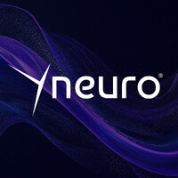
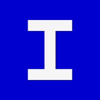
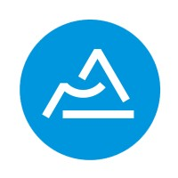
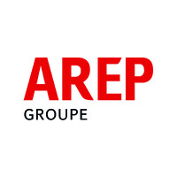
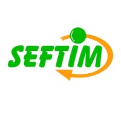
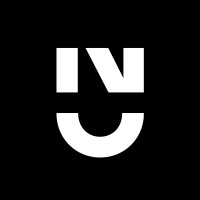
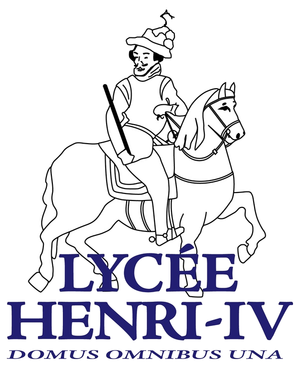
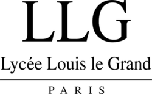
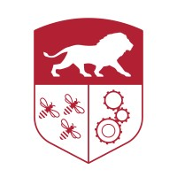
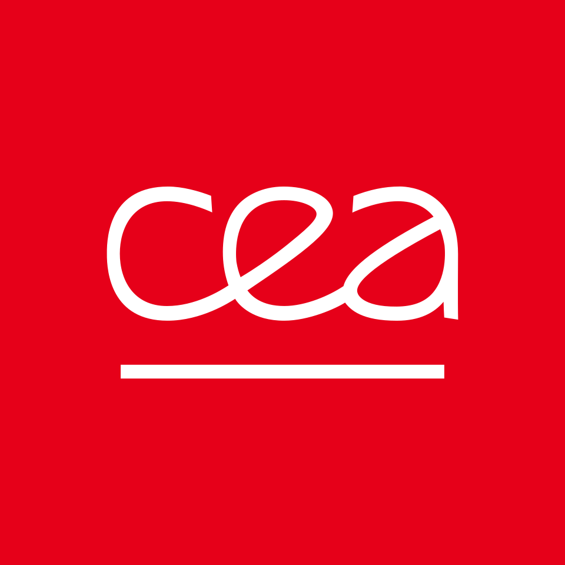

  <em>Dernière mise à jour le {{ site.time | date: "%d/%m/%Y" }}</em>

# Qui est Arnault ?

## Activités actuelles

Je suis le **Chief Scientific Officer** et **Founding Scientist** de **[Yneuro](https://www.yneuro.com/)**. J’y ai la responsabilité de la direction scientifique et R&D autour de **[Neuro ID®](https://www.linkedin.com/posts/tdsemah_neuro-id-live-on-stage-at-viva-technology-activity-7340992371196579843-w6q4/?utm_source=share&utm_medium=member_desktop&rcm=ACoAACEhyXYB-hpZDZ3p59wL-KyTViY6EwvFMaw)**, notre technologie brevetée d’authentification neuro-biométrique.<a class="home-inline-cta" href="/fr/cso-yneuro/" target="_self">En savoir plus</a>

Je suis également **Honorary Research Officer** à **[Imperial College London](https://profiles.imperial.ac.uk/arnault.caillet17)**, au sein du groupe [Neuromechanics and Rehabilitation Technology](https://www.imperial.ac.uk/neuromechanics-rehabilitation-technology/) du Pr Dario Farina. Mes travaux portent sur l’EMG, la modélisation neuromusculosquelettique et le contrôle moteur.

Je porte aussi des [collaborations de science ouverte à grande échelle](/fr/open-source/), dont le [EEG/EMG Foundation Challenge 2026](/fr/open-source/#open-challenges), que je coordonne avec Yneuro.

## Échangeons

Je défends une science rigoureuse, que l’on peut éprouver et mettre en pratique. Je suis toujours heureux de discuter de science et de nouvelles collaborations, autour de [Yneuro](/fr/cso-yneuro/), de [travaux de recherche](/fr/publications/) ou d’[initiatives de science ouverte](/fr/open-source/). Vous pouvez me joindre par [**email**](mailto:arnault@yneuro.com), sur [**LinkedIn**](https://www.linkedin.com/in/arnault-caillet-75a1a7136) ou à **Station F, à Paris**.

  <a href="/fr/cso-yneuro/" target="_self">
    <strong>CSO @ Yneuro</strong>
    Neuro ID®, feuille de route scientifique, rôle, équipe et médias.
  </a>
  <a href="/fr/publications/" target="_self">
    <strong>Publications</strong>
    Articles, brevets, abstracts, démonstrations et workshops.
  </a>
  <a href="/fr/open-source/" target="_self">
    <strong>Science ouverte</strong>
    Data, packages et compétitions EEG/EMG.
  </a>
  <a href="/fr/awards/" target="_self">
    <strong>Prix</strong>
    Prix et reconnaissances personnels et avec Yneuro.
  </a>
  <a href="/fr/supervision-teaching/" target="_self">
    <strong>Encadrement</strong>
    Encadrement scientifique, enseignement, coaching et formation technique.
  </a>

## Mon parcours, en bref

Je suis chercheur, entrepreneur et chef de projet, avec un parcours construit entre la France et le Royaume-Uni.

  

    20132014201520162017201820192020202120222023202420252026
  

  

    <strong>Route</strong>
    France 🇫🇷
    Royaume-Uni 🇬🇧
    France 🇫🇷
  

  <section class="home-lane home-lane--industry" aria-label="Fondations industrie et startup">
    <h3>Industrie & entrepreneuriat</h3>
    <article class="home-node home-node--startup">2015-2016<strong>Co-fondateur startup</strong>
CTO. Agriculture durable.
</article>
    <article class="home-node home-node--arep">2017<strong>Chef de projet technique</strong>
Génie civil.
</article>
    <article class="home-node home-node--quadrature">2022-2023<strong>Quadrature</strong>
Startup de prédiction du risque de blessure par modèles NMSK.
</article>
    <article class="home-node home-node--yneuro" data-href="/fr/cso-yneuro/" data-target="_self" role="link" tabindex="0">2023-<strong>Yneuro - CSO & Founding Scientist</strong>
R&D Neuro ID®, propriété intellectuelle, démos, produit et leadership scientifique.
</article>
  </section>

  <section class="home-lane home-lane--research" aria-label="Fondations recherche">
    <h3>Recherche</h3>
    <article class="home-node home-node--seftim">2016<strong>Lead science</strong>
Risques électriques.
</article>
    <article class="home-node home-node--ra" data-href="/fr/publications/" data-target="_self" role="link" tabindex="0">2018-2019<strong>Thesis & Res. Assistant</strong>
Modèles personnalisés NMSK (EMG, IRM, MoCap) et contact pied-sol.
</article>
    <article class="home-node home-node--phd" data-href="https://spiral.imperial.ac.uk/entities/publication/297847f5-ad14-4461-bacd-91172f0d55f0" data-target="_blank" role="link" tabindex="0">2020-2022<strong><a href="https://spiral.imperial.ac.uk/entities/publication/297847f5-ad14-4461-bacd-91172f0d55f0">PhD</a></strong>
Computational Neuroscience & Biomechanical Engineering, dans le groupe <a href="https://www.imperial.ac.uk/neuromechanics-rehabilitation-technology/">Neuromechanics & Rehabilitation Technology</a>.
</article>
    <article class="home-node home-node--assoc" data-href="/fr/publications/" data-target="_self" role="link" tabindex="0">2023-2024<strong>Research Associate</strong>
HD-EMG, contrôle moteur, 3 ERCs 🇪🇺 : <a href="https://cordis.europa.eu/project/id/810346">Natural BionicS</a>, <a href="https://gtr.ukri.org/projects?ref=EP%2FT020970%2F1">NISNEM</a>, <a href="https://www.hybridneuro.feri.um.si/">HybridNeuro</a>.
</article>
    <article class="home-node home-node--nantes" data-href="/fr/supervision-teaching/" data-target="_self" role="link" tabindex="0">2022-<strong>Visiting Researcher (Nantes Université)</strong>
Modélisation NMSK, adaptations musculaires et risque de blessure sportive.
</article>
    <article class="home-node home-node--officer" data-href="/fr/open-source/" data-target="_self" role="link" tabindex="0">2025-<strong>Research Officer</strong>
Projets de science ouverte, contrôle moteur et physiologie des unités motrices.
</article>
  </section>

  <section class="home-lane home-lane--open" aria-label="Fondations science ouverte">
    <h3>Science ouverte</h3>
    <article class="home-node home-node--publications" data-href="/fr/publications/" data-target="_self" role="link" tabindex="0">2019-<strong><a href="/fr/publications/" target="_self">Articles, données, code</a></strong>
Données publiques, code ouvert, articles, conférences et démos.
</article>
    <article class="home-node home-node--openpush" data-href="/fr/open-source/" data-target="_self" role="link" tabindex="0">2024-<strong><a href="/fr/open-source/" target="_self">Initiatives open source</a></strong>
MUniverse, MNE-EMG, Codabench, Braindecode, compétition EEG/EMG avec Yneuro et Imperial.
</article>
  </section>

  <section class="home-lane home-lane--engineering" aria-label="Fondations scientifiques et ingénierie">
    <h3>Fondations scientifiques & ingénierie</h3>
    <article class="home-node home-node--cpge">2013-2014<strong>Henri-IV → Louis-le-Grand</strong>
MPSI-PSI*, maths-physique.
</article>
    <article class="home-node home-node--centrale">2015-2018<strong>École Centrale de Lyon</strong>
Diplôme d’ingénieur généraliste.
</article>
    <article class="home-node home-node--imperial-msc">2017-2018<strong>Imperial College London</strong>
MSc General Structural Engineering. Award of Excellence (Valedictorian).
</article>
    <article class="home-node home-node--courses">2020-<strong>Formation continue</strong>
Gestion de projet scientifique, Git, machine learning et deep learning.
</article>
  </section>

  <section class="home-lane home-lane--teaching" aria-label="Leadership et mentorat">
    <h3>Leadership & mentorat</h3>
    <article class="home-node home-node--bde">2015-2016<strong>BDE</strong></article>
    <article class="home-node home-node--lecturer" data-href="/fr/supervision-teaching/" data-target="_self" role="link" tabindex="0">2017-2022<strong>Enseignement universitaire</strong>
Mécanique des solides à Centrale ; mécanique et analyse structurale à Imperial.
</article>
    <article class="home-node home-node--coach" data-href="/fr/supervision-teaching/" data-target="_self" role="link" tabindex="0">2017-2024<strong><a href="/fr/supervision-teaching/" target="_self">Tutorat & coaching universitaire 🇬🇧 🇫🇷 🇭🇰 🇺🇸</a></strong>
8 étudiants accompagnés du secondaire au Bachelor, dans 4 pays : maths, physique, chimie, informatique et candidatures universitaires.
</article>
    <article class="home-node home-node--msc-supervision" data-href="/fr/supervision-teaching/" data-target="_self" role="link" tabindex="0">2019-2024<strong>Encadrement MSc</strong>
7 étudiants MSc : exosquelettes, modélisation musculaire, ultrasons ultrarapides, HD-EMG.
</article>
    <article class="home-node home-node--phd-supervision" data-href="/fr/supervision-teaching/" data-target="_self" role="link" tabindex="0">2022-<strong>Encadrement doctoral</strong>
3 doctorants : modélisation MSK du sport et contrôle moteur, physiologie des unités motrices et ML appliqué à l’EMG, alignement multimodal EEG-fMRI.
</article>
  </section>

