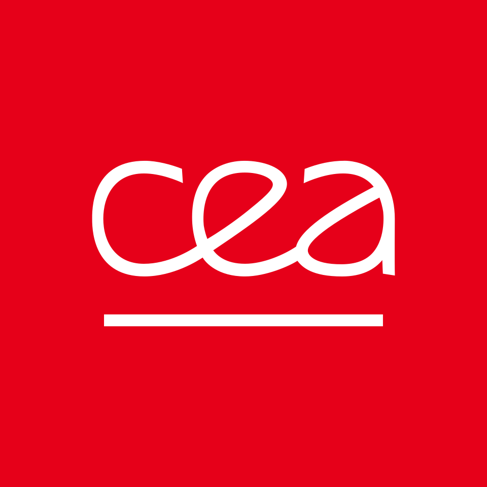

# Encadrement & enseignement

Depuis 2016, j’enseigne, encadre, et accompagne des étudiants, y compris sur des thèses et projets de Master.

  <section class="supervision__section">
    

      01
      

        <h2>Encadrement recherche</h2>
      

    

    

      <article class="supervision-card">
        2026-
        <h3>Encadrant de thèse</h3>
        
<strong>Bruna Lopes</strong>, <em>Improving non-invasive decoding by aligning foundation models with simultaneously acquired EEG and fMRI</em>.

        
CEA &amp; Inserm x Yneuro, doctorat CIFRE.

      </article>

      <article class="supervision-card">
        2024-
        <h3>Encadrant de thèse</h3>
        
Imperial College London.

      </article>

      <article class="supervision-card" data-href="https://www.linkedin.com/feed/update/urn:li:activity:7409185227580796929/" data-target="_blank" role="link" tabindex="0">
        2023-2025
        <h3>Encadrant de thèse</h3>
        
Dr. Titouan Morin, <a href="https://theses.fr/2025NANU1017"><em>Quantification of internal muscular training load: toward prediction and optimization of muscular adaptations</em></a>, Université de Nantes.

      </article>

      <article class="supervision-card">
        2022-2025
        <h3>Encadrement de mémoires de Master</h3>
        
Six mémoires de Master à Imperial College London, autour de la modélisation neuromusculaire, de l’estimation de force musculaire, de la prédiction de couples articulaires et du contrôle moteur computationnel.

      </article>

      <article class="supervision-card">
        2021
        <h3>Encadrant de stage</h3>
        
Imperial College London. Projet : <em>Automatic generation of long bone volumes using Statistical Shape Models</em>.

      </article>
    

  </section>

  <section class="supervision__section">
    

      02
      

        <h2>Enseignement & mentorat</h2>
      

    

    <ol class="supervision__timeline">
      <li>
        2023-2024
        

          <strong>University Coach</strong>
          University of Wisconsin-Madison, BSc Computer Science 🇺🇸
        

      </li>
      <li>
        2020-2022
        

          <strong>Teaching Assistant</strong>
          Imperial College London 🇬🇧 - Structural Mechanics 2 (BSc), Structural Analysis (MSc)
        

      </li>
      <li>
        2017-2024
        

          <strong>Tutorat</strong>
          Mathématiques, physique, chimie et informatique pour des élèves et étudiants au Royaume-Uni, en France, à Hong Kong et aux États-Unis 🇬🇧 🇫🇷 🇭🇰 🇺🇸
        

      </li>
      <li>
        2016-2017
        

          <strong>Chargé d’enseignement</strong>
          École Centrale de Lyon 🇫🇷 - mécanique des structures, niveau Bachelor.
        

      </li>
    </ol>

  </section>

